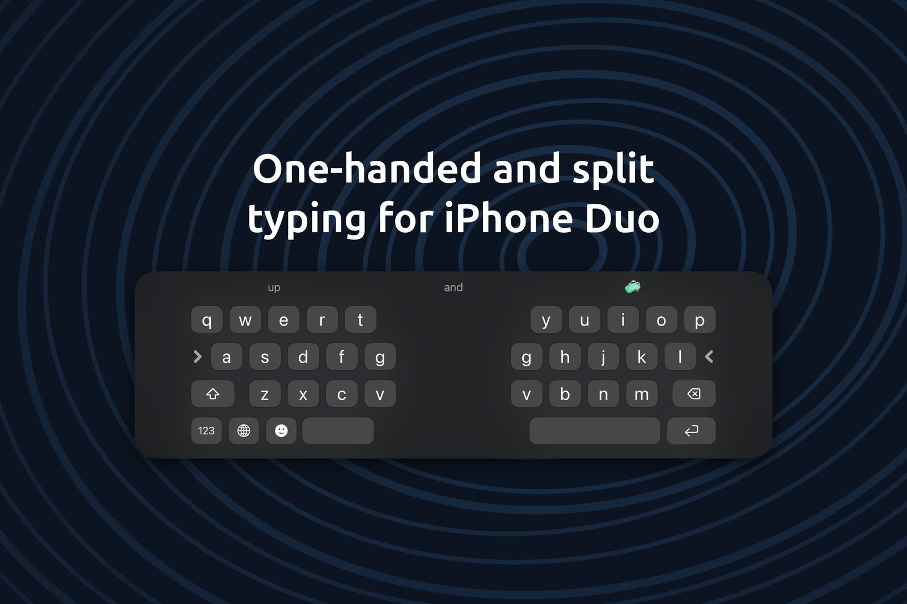

# floatey

A keyboard made especially for the iPhone Duo that looks and feels like the standard iPhone keyboard. It works on every iPhone, in portrait and landscape.

- Keys sized to match the standard keyboard on each screen and orientation, including both of the Duo's displays.
- Autocorrect, swipe typing and emoji, working like the standard keyboard.
- One-handed typing on every iPhone, and the Duo's split layout on its inner display.
- Nothing you type leaves your iPhone.

- [Support](support/)
- [Privacy policy](privacy/)
